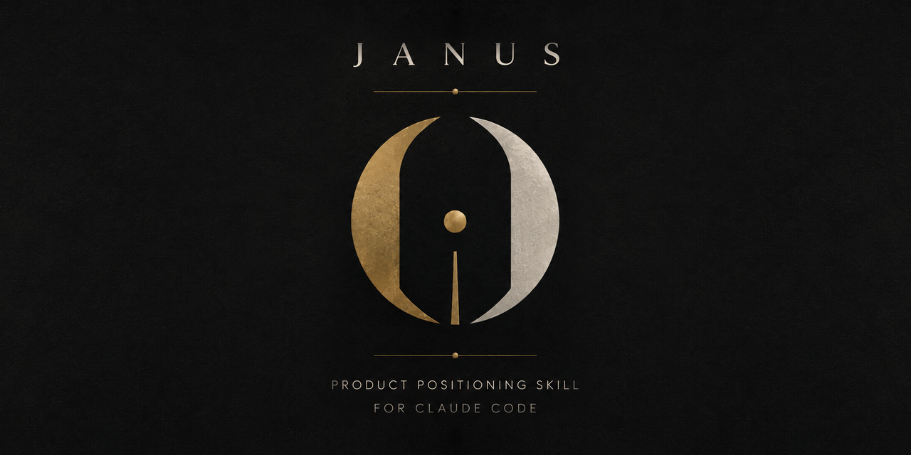

# Janusian

**Turn a product's contradictions into its positioning.**

An Agent Skill for Claude Code, Codex, Cursor, and other Agent-Skills-compatible tools.

---

## The gap this fills

Every published thinking framework treats a contradiction as a problem to dissolve:

| Framework | What it does with a contradiction |
|---|---|
| TRIZ | Resolves it — engineers the incompatibility away |
| Dialectical thinking | Collapses it — thesis, antithesis, **synthesis** |
| Inversion | Flips it — you still end up holding one side |
| Six Thinking Hats | Sequences it — one lens at a time |

Janusian does the opposite. Named for the god who faces both ways at once, it comes from
Albert Rothenberg's studies of highly creative scientists and artists: actively conceiving
two opposite ideas as **simultaneously true**, and refusing to resolve them.

Einstein's falling man is both at rest and in motion. The refusal is what produced general
relativity — not the compromise.

Applied to products: the mechanism that lets both poles be fully true **is** the
differentiator you were missing.

---

## Install

**Claude Code**

```bash
git clone https://github.com/<you>/janusian
cp -r janusian/janusian ~/.claude/skills/
```

Or drop the `janusian/` folder into `.claude/skills/` in a single project.

Then invoke it by name, or just describe a product contradiction and it will offer itself.

**Other agents** — the skill is a single `SKILL.md` with YAML frontmatter. It works anywhere
the Agent Skills format is supported.

---

## How it runs

1. **Name the pair** — with a fake-tension filter that discards preferences masquerading as contradictions
2. **Ban the three exits** — compromise, sequence, segment. Every other framework takes one of these
3. **Force simultaneity** — what must be true for both poles to be fully true, at once, for the same person?
4. **Harvest a mechanism** — not a slogan, not a balance. A quality gate rejects compromises in disguise
5. **Register the tension** — so a later decision can't quietly kill a pole without anyone noticing

---

## Example

| | |
|---|---|
| **A** | The honest promise is that you shouldn't need a fitness app. |
| **B** | The business needs daily engagement. |
| Exits killed | Streaks (compromise) · "graduate after 12 weeks" (sequence) · casual vs. serious tiers (segment) |
| Forced | What does daily use look like when the goal is your own obsolescence? |
| **Mechanism** | The metric shown to the user is **time-to-uninstall**, counting down. You open it daily to watch yourself need it less. |
| Position | *The only fitness app trying to lose you.* |

Both poles at full strength. No compromise, no sequence, no segmentation.

Two more worked examples are in the skill.

---

## Scope

**Use it for** product concept, positioning, offer design, naming, brand tensions.

**Don't use it for** architecture tradeoffs, debugging, or engineering decisions that should
resolve. The skill says so itself and will decline.

It fires rarely — a handful of times a year on a given product. The value is per-firing, not
per-day.

---

## The second payoff

The `## Held tensions` register it writes into your design doc is a tripwire.

Six months on, a reasonable-looking decision quietly kills one pole — a sync feature that
caches server-side, a pricing tier that charges for the thing you promised was free. Without
the register, nobody notices until the marketing site is telling a lie the code stopped
supporting.

With it, that drift is auditable.

---

## License

MIT
